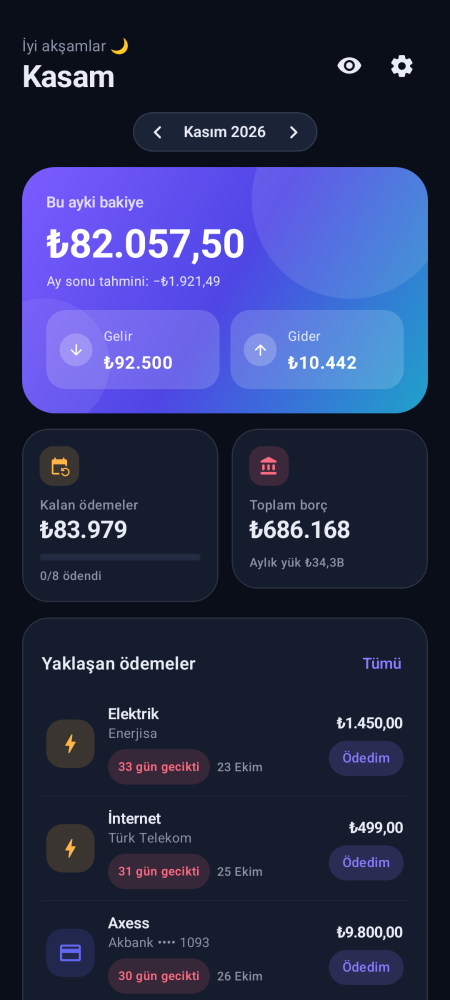
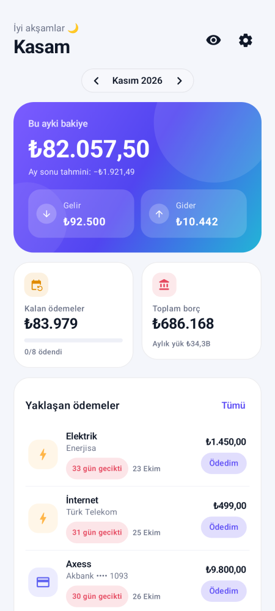
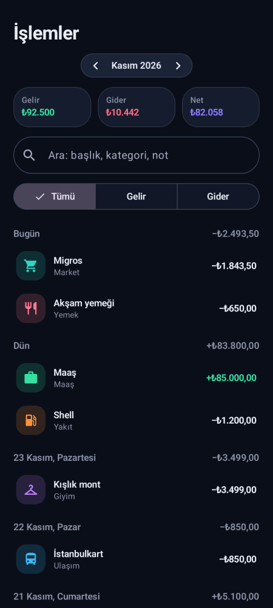
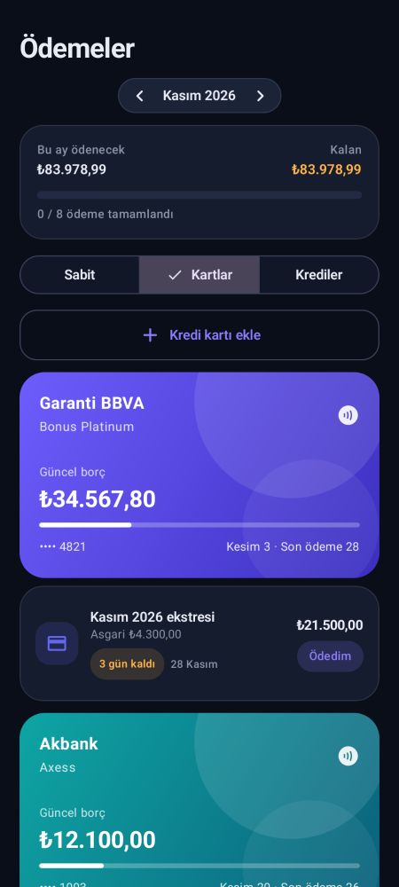
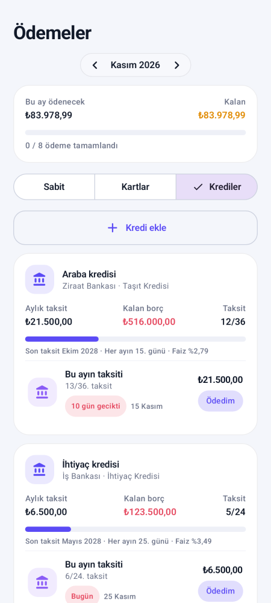
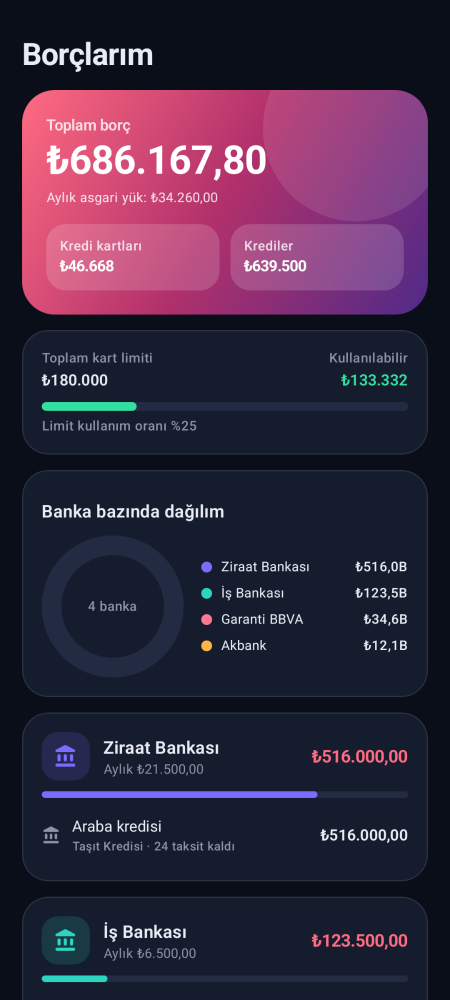

# Kasa — Kişisel Muhasebe

Aylık gelir/gider, sabit giderler, kredi kartları ve krediler için çevrimdışı, gizlilik odaklı Android uygulaması.

| Özet (koyu) | Özet (açık) | İşlemler |
|---|---|---|
|  |  |  |

| Kartlar | Krediler | Borçlar |
|---|---|---|
|  |  |  |

## Özellikler
- **Özet:** aylık bakiye, gelir/gider, ay sonu tahmini, yaklaşan ödemeler, kategori dağılımı.
- **İşlemler:** gelir/gider kaydı, kategori, tarih, not, arama, filtre, kaydırarak silme.
- **Sabit kalemler:** kira, fatura, abonelik, aidat ve maaş gibi her ay tekrar eden kalemler.
- **Kredi kartları:** banka, limit, güncel borç, dönem borcu, asgari ödeme, hesap kesim ve son ödeme günü.
- **Krediler:** banka, tür, anapara, taksit, ödenen/kalan taksit, faiz, kalan borç, son taksit tarihi.
- **Borçlarım:** hangi bankaya ne kadar borç olduğu, limit kullanımı, aylık yük.
- **Artan sıklıkta hatırlatma:** "Ödedim" denmeyen ödemeler için son güne yaklaştıkça bildirim sıklığı artar
  (7–4 gün: günde 1 · 3–2 gün: 12 saatte 1 · 1 gün: 6 saatte 1 · son gün: 3 saatte 1 · gecikme: 4 saatte 1).
  Bildirimden doğrudan **Ödedim** veya **1 saat ertele** seçilebilir. Sessiz saatler (23:00–08:00) desteklenir.
- **Güvenlik:** veriler yalnızca cihazda (Room/SQLite), internet izni yok, bulut yedekleme kapalı,
  biyometrik/ekran kilidi, ekran görüntüsü engelleme, tutarları gizleme, CSV dışa aktarımda formül enjeksiyonu koruması.

## Mimari
Kotlin · Jetpack Compose (Material 3) · Room · WorkManager · MVVM (tek `MainViewModel`, saf `ObligationEngine` / `ReminderPolicy`).
Tutarlar kuruş cinsinden `Long` olarak saklanır (kayan nokta hatası yok). Ödeme işaretleme işlemleri tek veritabanı
transaction'ı içinde ve idempotenttir (aynı ay için çift kayıt oluşmaz).

## Derleme
```bash
./gradlew testDebugUnitTest       # birim testleri
./gradlew assembleDebug           # debug APK
./gradlew assembleRelease         # imzalı release APK (keystore.properties gerekir)
```
`keystore.properties` (depoya eklenmez):
```
storeFile=release-keys/kasa-release.jks
storePassword=...
keyAlias=kasa
keyPassword=...
```
